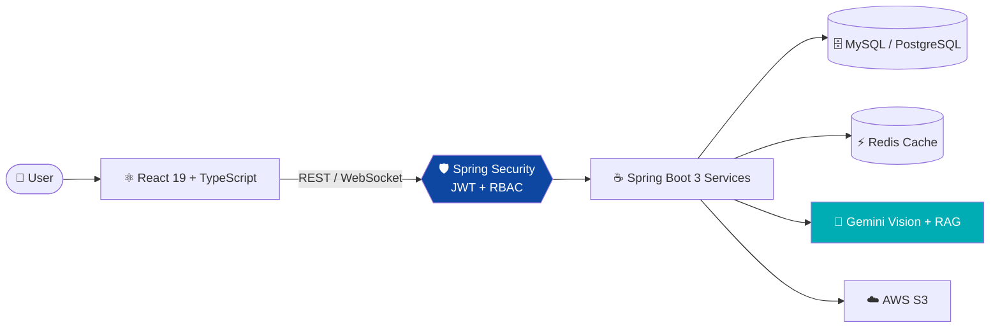
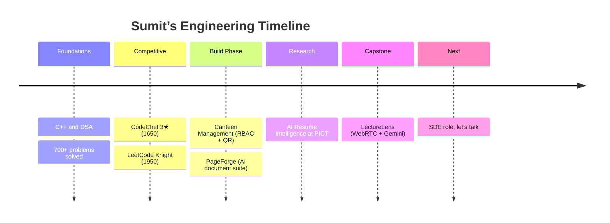

<div align="center">

<a href="https://racing-teal-dqrrc87.tmp.now/">

</a>


<br/><br/>

[](https://racing-teal-dqrrc87.tmp.now/)
[](https://www.linkedin.com/in/sumit-karkhile-73019a290)
[](https://leetcode.com/u/sumit_307/)
[](https://www.codechef.com/users/sai_812)
[](mailto:karkhilesumit5654@gmail.com)


</div>

---

## 🧭 Choose Your Path

<div align="center">

| 👔 I’m a Recruiter | 🧑‍💻 I’m an Engineer | 🤝 I’m a Collaborator |
| :---: | :---: | :---: |
| [Jump to 30-second scan ↓](#-recruiter-30-second-scan) | [Jump to projects ↓](#-flagship-projects) | [Jump to contact ↓](#-lets-build-something) |

</div>

---

## 👔 Recruiter 30-Second Scan

<table align="center">
<tr>
<td align="center" width="25%"><h1>9.45</h1><sub>CGPA / 10<br/>PICT Pune</sub></td>
<td align="center" width="25%"><h1>1950</h1><sub>LeetCode Max<br/>Knight 🥇</sub></td>
<td align="center" width="25%"><h1>700+</h1><sub>DSA Problems<br/>Solved</sub></td>
<td align="center" width="25%"><h1>1650</h1><sub>CodeChef<br/>3★</sub></td>
</tr>
</table>

> 🎯 **Looking for:** SDE Intern / Full-Time Software Development Engineer roles in backend or full-stack.
> 🛠️ **Strongest at:** Java 21 · Spring Boot 3 · JWT/RBAC security · React 19 · Docker · applied Generative AI.

---

## 🗺️ How I Build (Architecture Mindset)



---

## 🚀 Flagship Projects

<details open>
<summary><b>🎓 LectureLens</b> — Real-time classroom intelligence (Capstone)</summary>
<br/>


- 📡 Live WebRTC classroom streaming through a mediasoup SFU
- 🧠 Whiteboard OCR and Gemini visual analysis in real time
- 💬 RAG-powered Q&A so students can ask about what was just taught

[📂 Code](https://github.com/Sai600858) · [🚀 Demo](https://racing-teal-dqrrc87.tmp.now/)
</details>

<details>
<summary><b>📄 PageForge</b> — AI document engineering suite</summary>
<br/>


- ✨ AI text summarization and OCR extraction
- 💧 Watermarking and secure PDF transformation
- 🐳 Containerized, with files stored in S3

[📂 Code](https://github.com/Sai600858/Page-Forge) · [🚀 Demo](https://racing-teal-dqrrc87.tmp.now/)
</details>

<details>
<summary><b>🍽️ Canteen Management</b> — Secure cafeteria platform</summary>
<br/>


- 🔐 Role-based access control with HTTP-only cookie auth
- 🎟️ QR voucher generation and redemption
- ⚙️ Built to hold up under high concurrency

[📂 Code](https://github.com/Sai600858/CanteenSystem)
</details>

<details>
<summary><b>🧬 AI Resume Intelligence</b> — PICT research project</summary>
<br/>


- 📑 Automated PDF entity extraction
- 📐 Dense semantic cosine matching of resumes against job descriptions
</details>

---

## 🛠️ Tech Arsenal

<div align="center">


| Layer | Stack |
| :--- | :--- |
| ☕ **Backend** | `Java 21` `Spring Boot 3.3` `Spring Security` `JPA/Hibernate` `REST` `WebSocket` |
| ⚛️ **Frontend** | `React 19` `Next.js` `Vite` `TypeScript` `Tailwind CSS` |
| 🗄️ **Data** | `PostgreSQL` `MySQL` `Redis` `Flyway` |
| 🤖 **AI** | `Gemini API` `RAG` `Sentence-BERT` |
| ☁️ **DevOps** | `Docker` `GitHub Actions` `AWS S3` `Nginx` `Vercel` `Linux` |

</div>

---

## 📈 Journey



---

## 📊 Live Stats

<div align="center">


<a href="https://leetcode.com/u/sumit_307/"></a>


</div>

---

## 💻 Terminal Easter Egg

<details>
<summary><b>Click to run <code>./about_me.sh</code></b></summary>

```bash
sumit@pict:~$ ./about_me.sh
[✓] Loading Java 21 + Spring Boot modules...
[✓] Mounting 700+ solved DSA problems...
[✓] Connecting to Gemini Vision API...
[✓] Checking availability...

>> STATUS : Open for SDE Intern / Full-Time roles
>> MOTTO  : Discipline + clean architecture = impactful software
>> NEXT   : Your team? Let’s talk.
```
</details>

---

## 📬 Let’s Build Something

<div align="center">

<a href="https://racing-teal-dqrrc87.tmp.now/"></a>

<sub>📧 karkhilesumit5654@gmail.com · 📍 Pune, India</sub>


</div>
